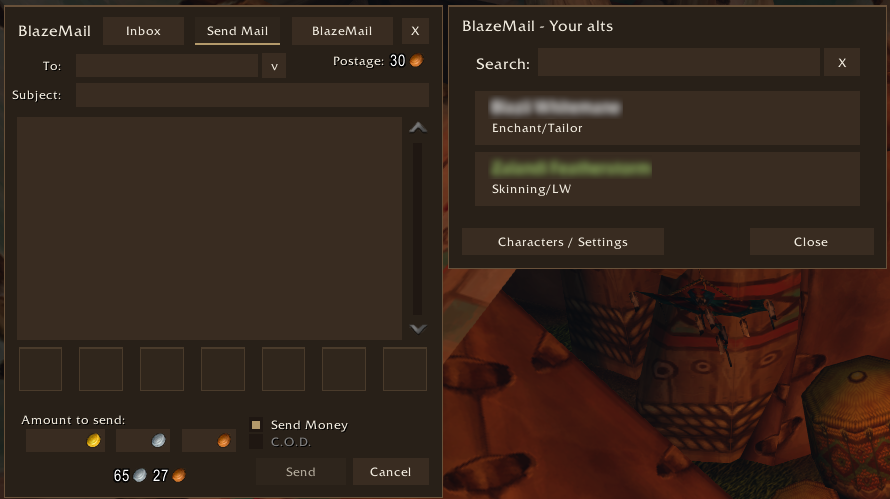
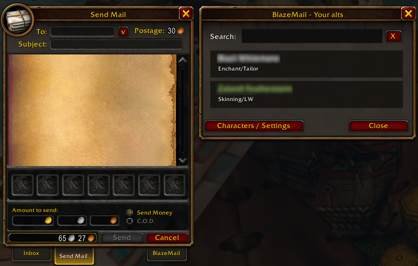
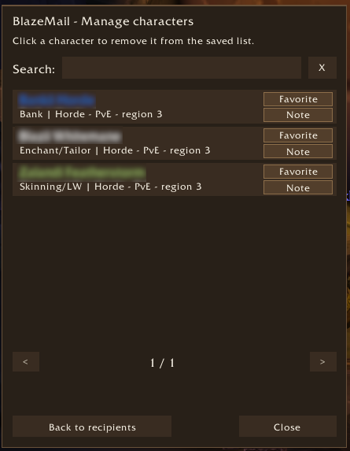

# BlazeMail

BlazeMail adds a searchable alt recipient picker, favorites, character notes,
and an optional custom mailbox theme to **World of Warcraft: Forever**.

## Features

- Select an alt to fill in the recipient field. Search by character name or note.
- Characters register as you log into them with the addon enabled. The picker
  shows characters matching your current faction and Forever ruleset.
- Mark favorites and add notes such as Bank, Alchemy, or Skinning/LW.
- Choose the dark brown and gold BlazeMail theme or Blizzard's original mailbox
  appearance. Theme selection is account-wide and requires a UI reload.
- After a successful send, the last recipient is filled in again, including
  manually entered recipients, for convenient repeat mailing.
- The account-wide Open Automatically option opens the picker when entering
  Send Mail and reopens it after a successful send. Use the small v button beside
  To to open it manually.

You send every message yourself; BlazeMail does not automatically send mail.

## Getting started

Download the named addon ZIP from [Releases](https://github.com/Blazeflack/BlazeMail/releases)
and extract the `BlazeMail/` folder into `Interface/AddOns`.
Previous releases are available in the [original repository](https://github.com/Blazeflack/WoW-AddOns/releases).
Log into each alt once with BlazeMail enabled, then visit a mailbox and open Send Mail.

Open Characters / Settings with `/bm`, `/blazemail`, or the BlazeMail mailbox button.
See [HOW_TO_USE.txt](HOW_TO_USE.txt) for the full guide.

## Screenshots

### Send Mail with the BlazeMail theme

### Send Mail with the Blizzard theme

### Characters / Settings

## Compatibility and development

Designed for WoW Forever. Compatibility with other WoW versions is not guaranteed.
No other addons are required.

See [CHANGELOG.md](CHANGELOG.md) for changes and
[RELEASING.md](RELEASING.md) for release instructions.

## License

[MIT](LICENSE). Copyright (c) 2026 Blazeflack.
